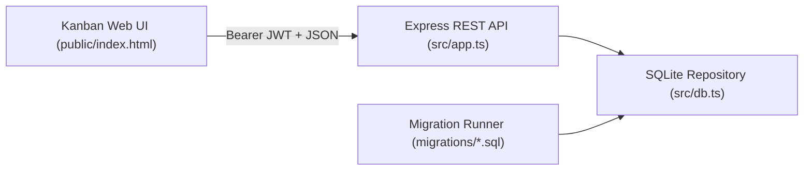

# TaskForge

Self-hosted Kanban project and task management platform built with TypeScript, Express, and SQLite (`node:sqlite`) featuring versioned SQL migrations.

## Purpose & Problem Statement

Many self-hosted project trackers require heavy external databases or complex microservices for small engineering teams. TaskForge delivers projects, Kanban columns, task labels, priorities, due dates, full-text filtering, activity audit logs, and user assignment notifications in a single Node.js service with transactional SQLite migrations.

## Features

- **Versioned SQL Migrations**: Incremental migration runner (`migrations/*.sql`) tracked in `schema_migrations` inside transactions.
- **Projects & Kanban Workflow**: Auto-provisions `backlog`, `in_progress`, `review`, and `done` columns per project with instant task transitions.
- **Task Metadata & Search**: Supports priorities (`low`, `medium`, `high`, `urgent`), due dates, assignees, colored labels, and combined query filtering (`q`, `priority`, `column`, `label`).
- **Activity History & Notifications**: Automatically logs project/task mutations in `activity_logs` and delivers assignment notifications with read tracking.
- **Security & Docker Compose**: Scrypt password hashing, JWT authentication, Helmet HTTP headers, and persistent `/data` Docker volumes.

## Tech Stack

- **Runtime & Framework**: Node.js 22.5+, TypeScript, Express 4, Helmet, `jsonwebtoken`
- **Database**: Built-in `node:sqlite` (`DatabaseSync`, WAL mode)
- **Frontend**: Vanilla HTML/CSS/JavaScript Kanban workspace

## System Requirements

- Node.js 22.5 or newer

## Installation

```bash
git clone https://github.com/fully-ai/taskforge.git
cd taskforge
npm ci
npm run build
npm run migrate
```

## Configuration

| Variable | Default | Description |
| --- | --- | --- |
| `TASKFORGE_HOST` | `127.0.0.1` | Bind address |
| `TASKFORGE_PORT` | `3100` | HTTP port |
| `TASKFORGE_DATA_DIR` | `./data` | SQLite database directory |
| `TASKFORGE_JWT_SECRET` | random per boot | JWT HMAC secret (set explicitly in production) |

## Running & Usage Examples

```bash
TASKFORGE_JWT_SECRET="replace-with-random-secret" npm start
```

Example API calls:

```bash
# Register user and obtain token
curl -s -X POST http://127.0.0.1:3100/api/auth/register \
  -H 'Content-Type: application/json' \
  -d '{"username":"lead","password":"strongpassword"}'

# Create a project
curl -s -X POST http://127.0.0.1:3100/api/projects \
  -H "Authorization: Bearer <TOKEN>" \
  -H 'Content-Type: application/json' \
  -d '{"key":"CORE","name":"Core Platform"}'

# Create an urgent task
curl -s -X POST http://127.0.0.1:3100/api/projects/<PROJECT_ID>/tasks \
  -H "Authorization: Bearer <TOKEN>" \
  -H 'Content-Type: application/json' \
  -d '{"title":"Enable TLS","priority":"urgent","due_date":"2026-12-01"}'
```

## API Documentation

| Method & Path | Auth | Description |
| --- | --- | --- |
| `GET /api/health` | Public | Health check |
| `POST /api/auth/register` / `POST /api/auth/login` | Public | User registration and JWT login |
| `GET /api/projects` / `POST /api/projects` | Bearer | List or create projects |
| `GET /api/projects/:id/board` | Bearer | Full Kanban board (project, columns, labels, tasks) |
| `POST /api/projects/:id/labels` | Bearer | Create project label |
| `GET /api/projects/:id/tasks` | Bearer | Search/filter tasks (`q`, `priority`, `column`, `label`) |
| `POST /api/projects/:id/tasks` | Bearer | Create task and notify assignee |
| `PATCH /api/tasks/:taskId` | Bearer | Update task fields or move between Kanban columns |
| `GET /api/projects/:id/activity` | Bearer | List recent project activity log entries |
| `GET /api/notifications` / `POST /api/notifications/:id/read` | Bearer | List or acknowledge assignment notifications |

## Architecture



## File Structure

```
taskforge/
├── migrations/
│   ├── 001_init.sql             # Core schema (users, projects, columns, tasks, labels, activity)
│   └── 002_notifications.sql    # Notifications table and indexes
├── src/
│   ├── app.ts                   # Express endpoints
│   ├── auth.ts                  # Scrypt hashing & JWT guards
│   ├── db.ts                    # Migration runner & SQLite queries
│   ├── migrate.ts               # Standalone migration CLI script
│   └── server.ts                # HTTP entrypoint
├── public/index.html            # Interactive Kanban board UI
├── tests/taskforge.test.mjs     # End-to-end API & migration tests
├── docs/architecture.md
├── Dockerfile
└── compose.yaml
```

## Testing

```bash
npm run lint
npm test
```

## Docker Deployment

```bash
TASKFORGE_JWT_SECRET="your-secret" docker compose up -d --build
```

## Security Notes

- Always configure `TASKFORGE_JWT_SECRET` in production and run behind HTTPS.

## Known Limitations

- Built-in columns (`backlog`, `in_progress`, `review`, `done`) are provisioned automatically per project; custom column creation via API is not exposed in v0.2.0.

## Contributing

See [CONTRIBUTING.md](CONTRIBUTING.md) and [CODE_OF_CONDUCT.md](CODE_OF_CONDUCT.md).

## License

Apache License 2.0 — see [LICENSE](LICENSE).
